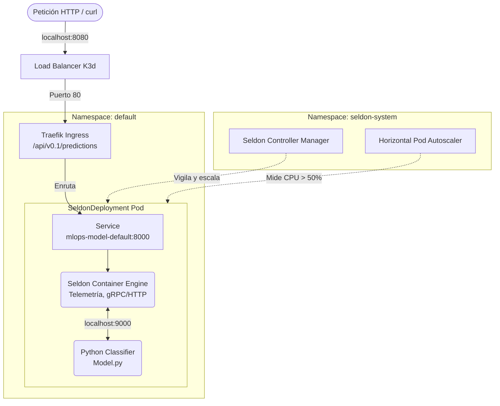
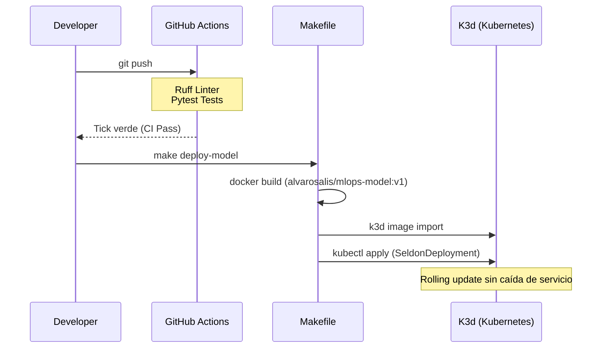

# MLOps Seldon Core deployment

Este repositorio define y automatiza el ciclo de vida de un modelo de Machine Learning en Kubernetes. Utiliza K3d para el entorno local, Seldon Core para la orquestación de inferencia y Traefik como Ingress Controller, todo unificado a través de un único `Makefile`.

El objetivo es abstraer la complejidad de Kubernetes para el equipo de Data Science, permitiendo desplegar, testear y monitorizar el modelo (incluyendo métricas de latencia y detección de data drift) mediante comandos simples.

## Arquitectura de red e inferencia

El tráfico entra al clúster a través del balanceador de K3d, es enrutado por Traefik hacia el servicio interno de Seldon y finalmente procesado por el modelo de Python. El sidecar de Seldon intercepta la petición para gestionar la telemetría y el escalado antes de pasar los datos al contenedor principal.



## Flujo de trabajo (CI/CD)

El pipeline de integración garantiza que el código cumple con los estándares estáticos antes de empaquetar la imagen y actualizar el clúster.



## Operativa del proyecto

Toda la interacción con el clúster y el entorno de pruebas está envuelta en el `Makefile`. No es necesario ejecutar comandos de `kubectl` ni `docker` de forma manual.

### 1. Levantamiento del entorno
Inicia el clúster local de Kubernetes e instala el operador de Seldon en su propio namespace:
```bash
make create-cluster
make install-seldon
```

### 2. Despliegue del modelo
Compila el código Python en una imagen Docker, la inyecta directamente en los nodos de K3d y aplica las reglas de red:
```bash
make deploy-model
make status
```

### 3. Validaciones
*   **Prueba de carga (Locust):** Ataca el endpoint para disparar el Horizontal Pod Autoscaler (HPA).
    ```bash
    make test-load
    ```
*   **Data Drift:** Ejecuta un test estadístico (Kolmogorov-Smirnov) sobre los inputs históricos del modelo para detectar degradación.
    ```bash
    make check-drift
    ```

## Requisitos previos
*   WSL2 con Docker Desktop o Docker Engine demonizado.
*   `k3d` y `helm` instalados a nivel de sistema.
*   Entorno virtual de Python aislado para desarrollo local (ignorado por el linter).