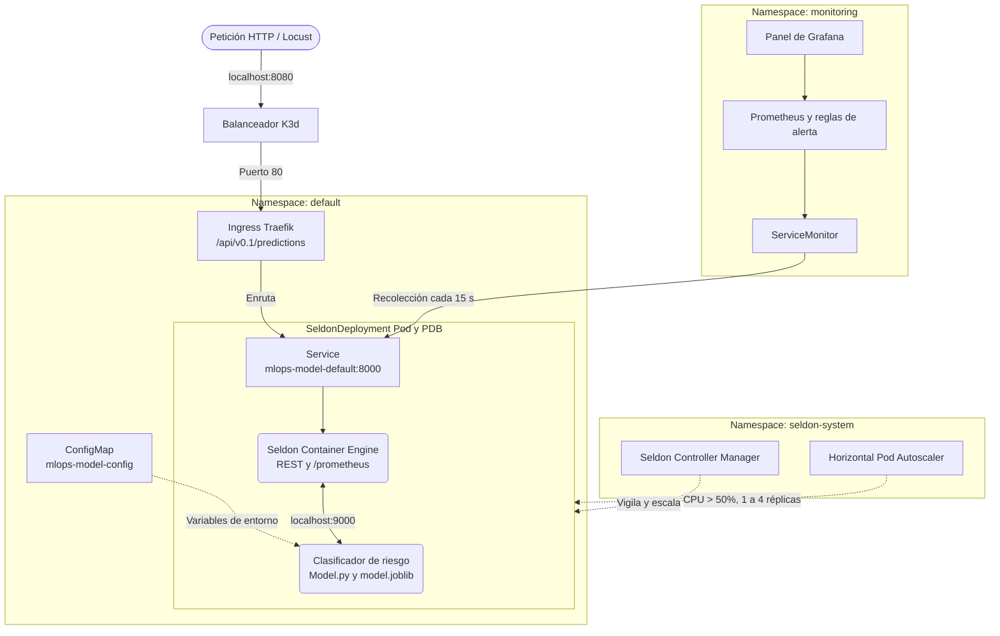
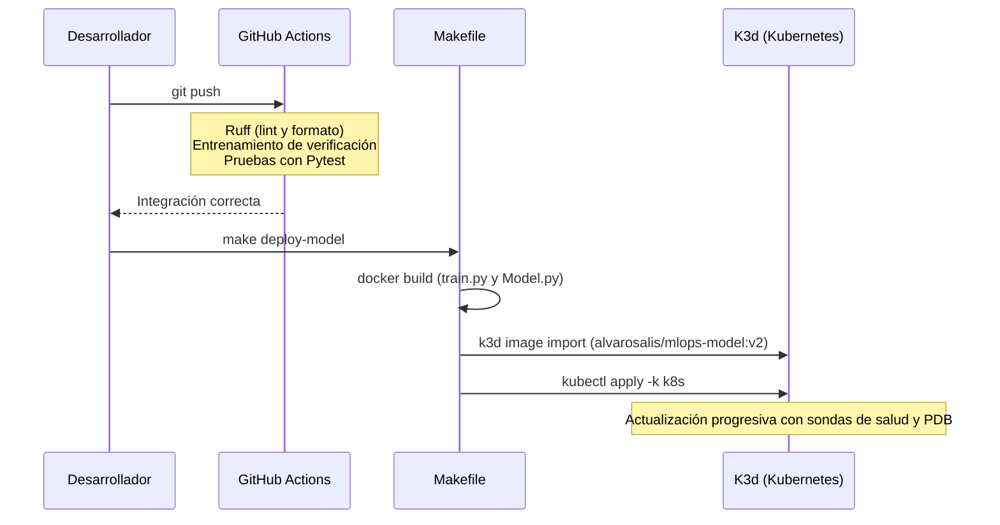

# Despliegue MLOps con Seldon Core

Este repositorio define y automatiza el ciclo de vida de un modelo de aprendizaje automático en Kubernetes orientado a la clasificación de riesgo crediticio. Utiliza K3d para el clúster local, Seldon Core para la orquestación de inferencia, Traefik como controlador de entrada, Kustomize para gestionar los manifiestos y Prometheus junto con Grafana para la observabilidad, todo centralizado en un único `Makefile`.

El objetivo es abstraer la complejidad de Kubernetes para el equipo de ciencia de datos, permitiendo entrenar, desplegar, probar bajo carga y monitorizar el modelo (incluyendo métricas de latencia y detección de desviación de datos) mediante comandos simples.

## Modelo y pipeline de entrenamiento

El servicio expone un clasificador binario (`approved` frente a `default`) construido con `scikit-learn`:

* **Datos reproducibles (`model/src/data.py`):** genera un conjunto tabular de ocho variables financieras (`age`, `annual_income`, `employment_years`, `loan_amount`, `interest_rate`, `debt_to_income`, `credit_score` y `num_open_accounts`) con correlaciones entre variables, frontera no lineal y un porcentaje controlado de valores nulos.
* **Preprocesamiento (`ColumnTransformer`):** aplica imputación por mediana y `RobustScaler` sobre las variables monetarias (`annual_income` y `loan_amount`), e imputación por mediana junto con `StandardScaler` sobre el resto de variables.
* **Selección de modelo (`model/src/train.py`):** evalúa `LogisticRegression`, `RandomForestClassifier` y `GradientBoostingClassifier` mediante validación cruzada estratificada de 5 particiones (métrica ROC AUC), selecciona el mejor candidato, lo evalúa sobre el conjunto de prueba y genera:
  * `model/artifacts/model.joblib`: pipeline serializado listo para inferencia.
  * `model/artifacts/metadata.json`: versión, algoritmo seleccionado, métricas de evaluación, importancia de variables y estadísticas de distribución.
  * `model/data/reference_data.csv`: distribución de referencia que consume el detector de desviación de datos.
* **Servicio de inferencia (`model/src/Model.py`):** valida el esquema de entrada, reordena columnas cuando se envía `features_names`, imputa valores faltantes de forma transparente, devuelve probabilidades por clase y expone comprobaciones de salud (`/health/status`, `/health/ping`) así como métricas personalizadas de Seldon para Prometheus.

## Estructura del repositorio

```text
.
├── .github/workflows/ci.yml        # Integración continua con Ruff, entrenamiento y Pytest
├── drift/                          # Auditoría estadística de desviación de datos (Kolmogorov Smirnov)
├── k8s/
│   ├── base/                       # Manifiestos base de Kustomize (ConfigMap y PDB)
│   ├── monitoring/                 # Valores de Prometheus, ServiceMonitor, alertas y panel de Grafana
│   ├── seldon/                     # SeldonDeployment (HPA y sondas de salud) e Ingress de Traefik
│   └── kustomization.yaml          # Punto de entrada de Kustomize (base + seldon)
├── locust/                         # Pruebas de carga con tráfico individual, lotes y perfiles de alto riesgo
├── model/
│   ├── artifacts/                  # Metadatos del modelo y artefacto serializado tras entrenar
│   ├── data/                       # Muestra de referencia y documentación del esquema
│   ├── notebooks/                  # Cuaderno de análisis exploratorio y selección de modelo
│   ├── src/                        # Esquema, generación de datos, entrenamiento y clase Model
│   └── Dockerfile                  # Construcción de imagen con entrenamiento integrado y usuario sin privilegios
└── tests/                          # Pruebas de entrenamiento, inferencia y detección de drift
```

## Arquitectura de red, inferencia y observabilidad

El tráfico entra al clúster a través del balanceador de K3d, Traefik lo enruta hacia el servicio interno de Seldon y el contenedor del modelo calcula las probabilidades de impago. El contenedor auxiliar de Seldon gestiona la telemetría, las métricas expuestas en `/prometheus` y el escalado horizontal.



## Flujo de trabajo (CI/CD)

El flujo de integración continua valida el estilo, el formato, el entrenamiento y las pruebas automáticas antes de construir la imagen y actualizar el clúster.



## Operativa del proyecto

Toda la interacción con el entrenamiento, el clúster y las validaciones está encapsulada en el `Makefile`.

### 1. Entrenamiento local y calidad de código

```bash
make train
make lint
make test
```

### 2. Levantamiento del entorno

Inicia el clúster local de Kubernetes, instala el operador de Seldon y, de forma opcional, despliega el bloque de observabilidad con Prometheus y Grafana:

```bash
make create-cluster
make install-seldon
make install-monitoring
```

### 3. Despliegue del modelo

Construye la imagen Docker (entrenando el artefacto con la versión exacta de `scikit-learn` del contenedor), la importa en los nodos de K3d y aplica los manifiestos mediante Kustomize:

```bash
make deploy-model
make status
```

Ejemplo de consulta de inferencia con `curl`:

```bash
curl -X POST http://localhost:8080/api/v0.1/predictions \
  -H "Content-Type: application/json" \
  -d '{
    "data": {
      "names": ["age", "annual_income", "employment_years", "loan_amount", "interest_rate", "debt_to_income", "credit_score", "num_open_accounts"],
      "ndarray": [[38, 78000, 7.5, 18000, 9.2, 0.24, 710, 6]]
    }
  }'
```

### 4. Validaciones y observabilidad

* **Prueba de carga (Locust):** genera tráfico realista (consultas individuales, lotes de 16 solicitudes y perfiles de alto riesgo) para activar el escalado automático:
  ```bash
  make test-load
  ```
* **Desviación de datos:** ejecuta una auditoría estadística de Kolmogorov Smirnov con corrección de Bonferroni frente a `model/data/reference_data.csv` y guarda el informe en formato JSON:
  ```bash
  make check-drift
  ```
* **Grafana:** expone el panel autoprovisionado en `http://localhost:3000`:
  ```bash
  make port-forward-grafana
  ```

## Requisitos previos

* Linux o WSL2 con Docker Desktop o Docker Engine en ejecución.
* `k3d`, `kubectl` y `helm` instalados en el sistema.
* Entorno virtual de Python aislado (`.venv`) para desarrollo local.
